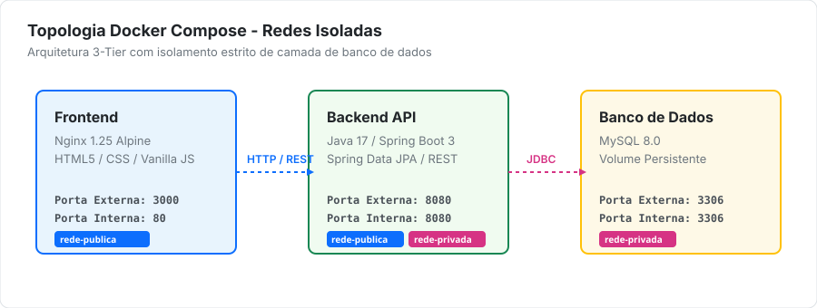

# BookFlow - Sistema de Gestao Bibliotecaria em Contêineres

Aplicacao full-stack desenvolvida para a atividade pratica individual de implantacao com Docker e Docker Compose, composta por tres camadas independentes (Frontend, Backend e Banco de Dados) conectadas por redes distintas.

---

## 1. Visao Geral e Funcionalidades

O BookFlow e uma aplicacao completa para gerenciamento de acervos bibliograficos. Ela permite realizar todas as operacoes de cadastro e controle de emprestimos de livros:

- Listagem completa do acervo com contadores dinamicos em tempo real (Total de livros, Disponiveis, Emprestados e Categorias).
- Cadastro de novos livros vinculados a categorias especificas com validacao de campos e ISBN.
- Cadastro de novas categorias diretamente pela interface web.
- Filtragem rapida de livros por categoria ou por busca textual (titulo, autor, ISBN).
- Alternancia de situacao (Disponivel para Emprestado e vice-versa) com apenas um clique.
- Exclusao de registros do acervo com confirmacao.

---

## 2. Telas da Aplicacao

### Painel Principal (Acervo e Estatisticas)
Visualizacao consolidada do acervo com indicadores estatisticos no topo, filtros de busca por categoria e listagem com botoes de acao.


### Cadastro de Novos Livros
Formulario modal para inclusao de novas obras no catalogo com selecao dinamica de categorias vindas do banco de dados.


---

## 3. Arquitetura e Topologia Docker

A solucao adota uma arquitetura 3-Tier real, onde cada componente e executado em um conteiner Docker isolado:



### Descricao dos Conteineres

1. **Frontend (`bookflow-frontend`)**:
   - Imagem base: `nginx:alpine`
   - Tecnologia: HTML5, CSS3, JavaScript Vanilla e Bootstrap 5
   - Porta Externa: 3000 (Mapeada para a porta interna 80)
   - Funcao: Serve a interface web e atua como proxy reverso para os endpoints da API (`/api/`), evitando problemas de CORS e mantendo comunicacao interna segura.

2. **Backend (`bookflow-backend`)**:
   - Imagem base: Multi-stage com `maven:3.9.6-eclipse-temurin-17` e `eclipse-temurin:17-jre-alpine`
   - Tecnologia: Java 17, Spring Boot 3, Spring Data JPA, Spring Web
   - Porta Externa: 8080 (Mapeada para a porta interna 8080)
   - Funcao: Fornece a API RESTful de negocios, manipulando entidades (`Book`, `Category`, `User`, `Role`) e persistencia.

3. **Banco de Dados (`bookflow-database`)**:
   - Imagem base: `mysql:8.0`
   - Porta Externa: 3306 (Mapeada para a porta interna 3306)
   - Persistencia: Volume Docker nomeado `db_data` montado em `/var/lib/mysql`
   - Funcao: Armazenamento relacional dos dados com garantia de persistencia mesmo apos a parada dos conteineres.

### Isolamento por Redes Bridge

O ambiente utiliza duas redes internas independentes para garantir o principio de menor privilegio e seguranca em camadas:

- **`rede-publica`**: Conecta exclusivamente o `frontend` e o `backend`.
- **`rede-privada`**: Conecta exclusivamente o `backend` e o `database`.
- **Politica de Seguranca**: O conteiner do banco de dados nao pertence a `rede-publica`, impossibilitando qualquer acesso direto vindo do frontend ou de clientes externos nao autorizados.

---

## 4. Endpoints da API REST

A comunicacao entre o Frontend e o Backend ocorre via protocolo HTTP/JSON:

| Metodo | Endpoint | Descricao |
| :--- | :--- | :--- |
| GET | `/api/books` | Retorna todos os livros cadastrados |
| GET | `/api/books?categoryId={id}` | Filtra livros por categoria |
| POST | `/api/books` | Cadastra um novo livro |
| PUT | `/api/books/{id}` | Atualiza informacoes de um livro |
| PATCH | `/api/books/{id}/toggle` | Alterna a situacao entre Disponivel e Emprestado |
| DELETE | `/api/books/{id}` | Exclui um livro do acervo |
| GET | `/api/categories` | Lista todas as categorias cadastradas |
| POST | `/api/categories` | Cria uma nova categoria |
| POST | `/api/auth/login` | Autentica usuarios do sistema |

---

## 5. Como Executar o Projeto

### Pre-requisitos
- Docker instalado (versao 20.10 ou superior)
- Docker Compose instalado (versao v2 ou superior)

### Passo a Passo

1. Clone o repositorio:
   ```bash
   git clone https://github.com/rtobias-git/ProjetoInfra.git
   cd ProjetoInfra
   ```

2. Inicialize todos os conteineres em segundo plano:
   ```bash
   docker compose up -d --build
   ```

3. Verifique se os tres conteineres estao ativos e saudaveis:
   ```bash
   docker compose ps
   ```

4. Acesse a aplicacao no navegador:
   - Frontend: `http://localhost:3000`
   - Backend API: `http://localhost:8080/api/books`

5. Para parar a execucao mantendo os dados salvos:
   ```bash
   docker compose down
   ```

6. Para parar e remover volumes (limpeza completa):
   ```bash
   docker compose down -v
   ```
