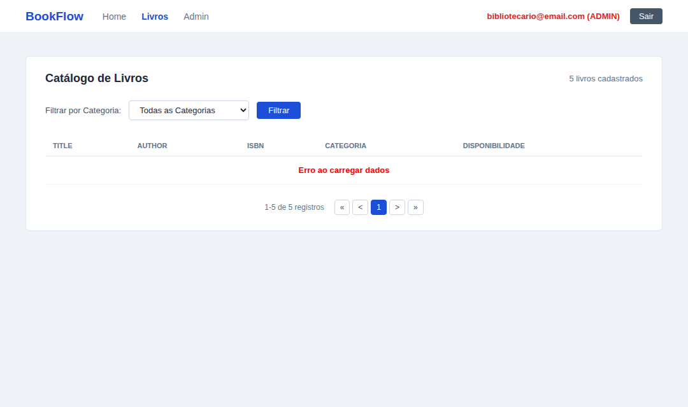
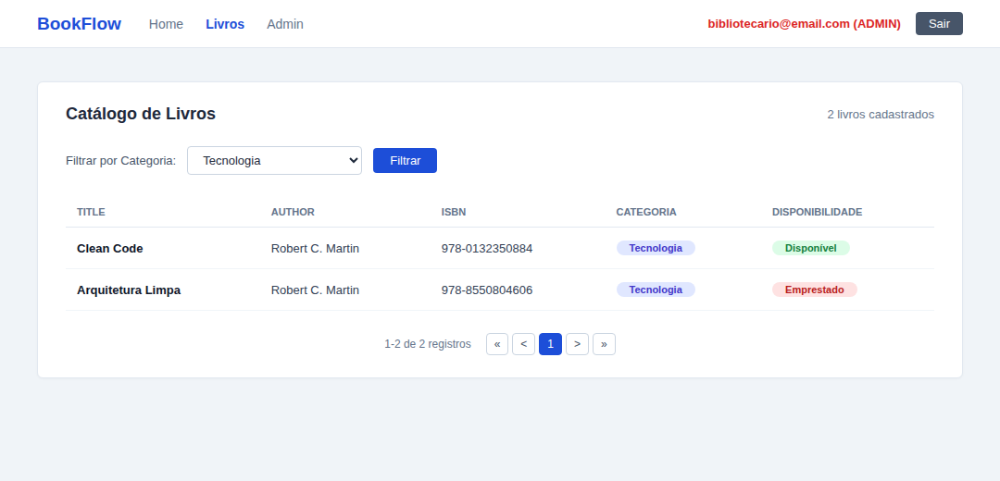
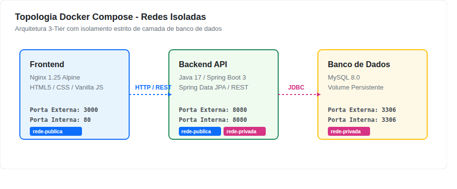

# BookFlow - Sistema de Gestao Bibliotecaria em Conteineres

Aplicacao full-stack desenvolvida para a atividade pratica individual de implantacao com Docker e Docker Compose, composta por tres camadas independentes (Frontend, Backend e Banco de Dados) conectadas por redes distintas.

---

## 1. Visao Geral e Funcionalidades

O BookFlow e uma aplicacao voltada para administracao e consulta de acervos bibliograficos em bibliotecas:

- Listagem de livros cadastrados com exibicao de titulo, autor, ISBN, categoria e situacao do exemplar.
- Filtro rapido de obras por categoria selecionada (Tecnologia, Engenharia, Ficcao, Literatura).
- Controle visual de disponibilidade do exemplar atraves de marcadores (Disponivel ou Emprestado).
- Contador dinamico do total de obras cadastradas e barra de paginacao.
- Barra superior de navegacao com identificacao do usuario autenticado (bibliotecario@email.com - ADMIN) e botao de encerramento de sessao.

---

## 2. Demonstracao das Funcionalidades

### Funcionalidade 1: Catalogo Completo de Livros
Exibicao de todo o acervo registrado no banco de dados com seus respectivos dados cadastrais, identificador ISBN e marcadores visuais de situacao.



---

### Funcionalidade 2: Filtragem por Categoria
Permite selecionar uma categoria especifica no menu dropdown e atualizar a listagem para exibir apenas as obras correspondentes, recalculando o total de registros.



---

### Funcionalidade 3: Controle de Disponibilidade de Exemplares
Diferenciacao visual clara entre obras disponiveis para consulta/retirada (destaque verde) e obras atualmente emprestadas (destaque vermelho), permitindo gestao imediata do acervo.

---

## 3. Arquitetura e Topologia Docker

A solucao adota uma arquitetura 3-Tier com tres servicos isolados:



### Descricao dos Conteineres

1. **Frontend (`bookflow-frontend`)**:
   - Imagem base: `nginx:alpine`
   - Tecnologia: HTML5, CSS3 e JavaScript Vanilla puro
   - Porta Externa: 3000 (Mapeada para a porta interna 80)
   - Funcao: Serve os arquivos estaticos e encaminha chamadas para a API (`/api/`) via proxy reverso.

2. **Backend (`bookflow-backend`)**:
   - Imagem base: Multi-stage com `maven:3.9.6-eclipse-temurin-17` e `eclipse-temurin:17-jre-alpine`
   - Tecnologia: Java 17, Spring Boot 3, Spring Data JPA
   - Porta Externa: 8080 (Mapeada para a porta interna 8080)
   - Funcao: Processamento das requisicoes de consulta e negocios, manipulando as entidades e a conexao com o banco.

3. **Banco de Dados (`bookflow-database`)**:
   - Imagem base: `mysql:8.0`
   - Porta Externa: 3306 (Mapeada para a porta interna 3306)
   - Persistencia: Volume Docker nomeado `db_data` montado em `/var/lib/mysql`
   - Funcao: Armazenamento relacional dos dados com garantia de persistencia.

### Isolamento por Redes Bridge

O ambiente utiliza duas redes internas independentes:

- **`rede-publica`**: Conecta exclusivamente o `frontend` e o `backend`.
- **`rede-privada`**: Conecta exclusivamente o `backend` e o `database`.
- **Politica de Seguranca**: O conteiner do banco de dados nao pertence a `rede-publica`, impedindo conexoes diretas do frontend ao banco.

---

## 4. Endpoints da API REST

| Metodo | Endpoint | Descricao |
| :--- | :--- | :--- |
| GET | `/api/books` | Retorna todos os livros cadastrados |
| GET | `/api/books?categoryId={id}` | Filtra livros por categoria |
| POST | `/api/books` | Cadastra um novo livro |
| GET | `/api/categories` | Lista todas as categorias |
| POST | `/api/categories` | Cadastra uma nova categoria |

---

## 5. Como Executar o Projeto

### Pre-requisitos
- Docker instalado
- Docker Compose instalado

### Passo a Passo

1. Clonar o repositorio:
   ```bash
   git clone https://github.com/rtobias-git/ProjetoInfra.git
   cd ProjetoInfra
   ```

2. Inicializar os conteineres:
   ```bash
   docker compose up -d --build
   ```

3. Verificar os conteineres em execucao:
   ```bash
   docker compose ps
   ```

4. Acessar no navegador:
   - Frontend: `http://localhost:3000`
   - Backend API: `http://localhost:8080/api/books`

5. Para parar a aplicacao mantendo os dados persistidos:
   ```bash
   docker compose down
   ```
